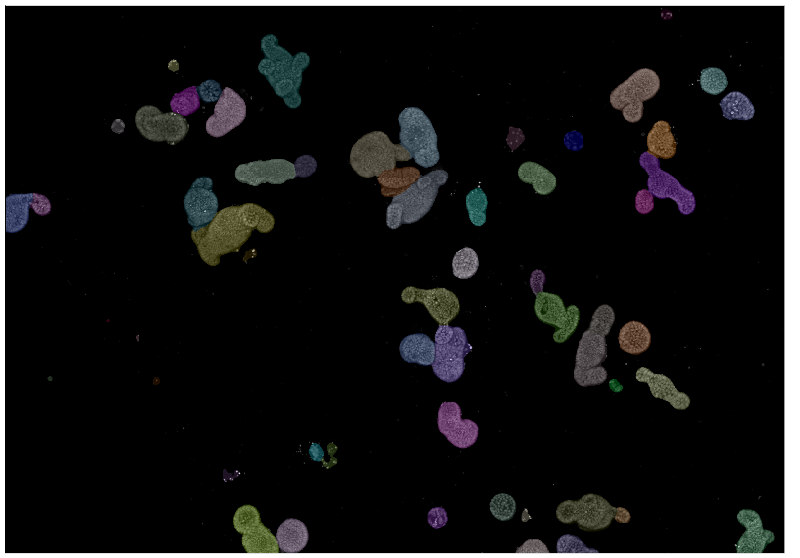
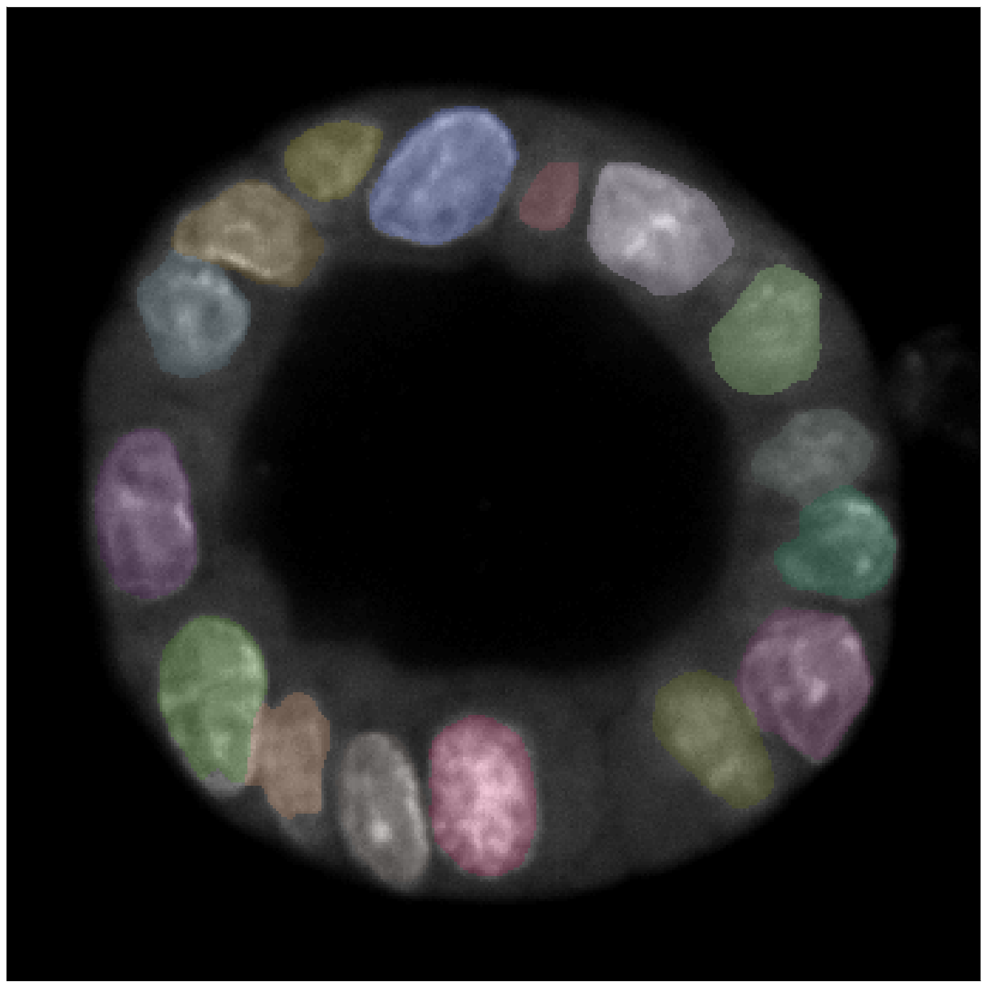
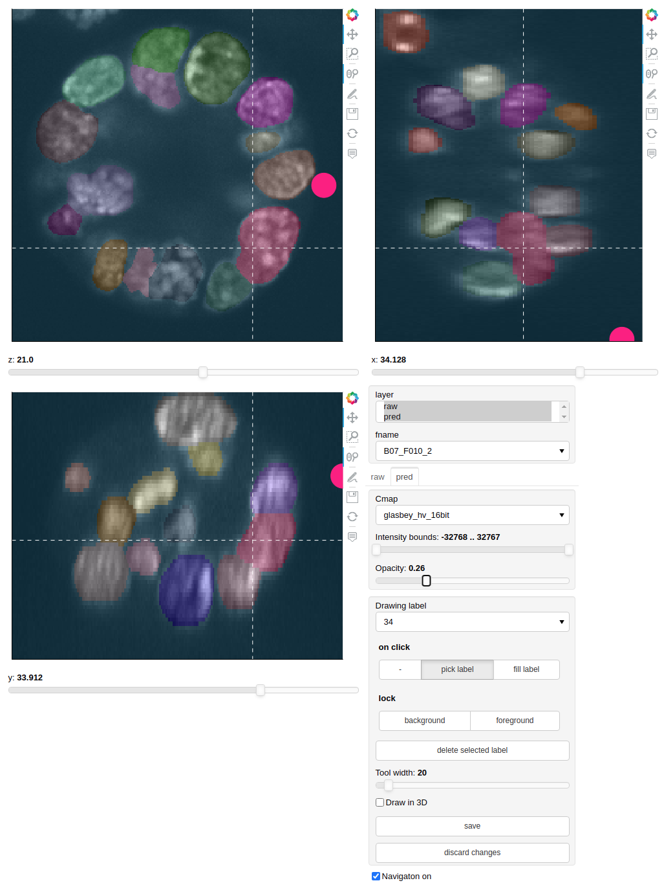

# ISIT
2D/3D Instance Segmentation with Iterative Training. Once an initial model is trained, the notebooks provided in [inter-view](https://github.com/fmi-basel/inter-view) can be used to hand-pick bad predictions and correct them before retraining.


This essentially wraps training and prediction steps using [RDCNet](https://github.com/fmi-basel/RDCNet) in [Luigi](https://github.com/spotify/luigi) tasks.

## Installation
It is recommended to create a new python environment and install visualization libraries and cuda (GPU support) with conda:

```bash
conda create -n isit python=3.7
conda activate isit
conda install -c pyviz holoviews bokeh panel param xarray datashader pytables
conda install cudatoolkit=10.1 cudnn=7

git clone https://github.com/fmi-basel/isit.git
pip install isit/
```


## Usage

Config such as path to the data, model architecture, etc. can be defined in a config file. 3 examples are provided as a starting point. The full list of options along with a short description can be displayed by passing the `--help` option to the task of in interest, e.g. `luigi --module isit InstanceModelExportTask --help`

The training datasets should contain a json file describing at least the pixel/voxel size (spacing). For example:

```json
{
    "experiment_path": "PATH_TO_RAW_DATA",
    "mag": 40,
    "markers": {"1": "DAPI"},
    "remarks": "Samples containing debris",
    "spacing": [0.161,0.161],
    "timepoint": 48,
    "microscope":"yokogawa",
    "wavelengths": {"1": 488},
    "annotator":"USERNAME"
}
```

Training a model:
```bash
LUIGI_CONFIG_PATH=./training_config.cfg luigi --local-scheduler --module isit InstanceModelExportTask
```

Applying a model:
```bash
LUIGI_CONFIG_PATH=./predict_config.cfg luigi --local-scheduler --module isit SegmentInstancesTask
```

Applying a 2D model to each slice of a 3D stack:
```bash
LUIGI_CONFIG_PATH=./predict_config.cfg luigi --local-scheduler --module isit BatchedSegmentInstancesTask
```

## Examples
**2D-mip-org-seg**: organoids segmentation on overview images acquired on the yokogawa<br/>
<br/><br/>

**2D-nuclei-seg**: nuclei segmentation on organoid images acquired on the yokogawa<br/>
<br/><br/>

**3D-nuclei_seg**: 3D nuclei segmentation on images acquired on the yokogawa, with 60X objective and 0.6 um z-sampling<br/>
<br/><br/>


### Hyperparameters selection for the model architecture
These few rules of thumb can be used to select hyperparameters for a new project (taken from https://github.com/fmi-basel/RDCNet)

- **down/up sampling factor** highest factor where instances can still be visually recognized
- **max dilation rate** `object_size << 2 * dilation_rate * downsampling_factor << training_patch_size`
- **network capacity** primarily adjust the number of groups and channels per group
- **number of iterations** 5-6 is usually a good balance between performances and computational cost

### Implementation details
The trained models are exported as standalone tensorflow graphs that include normalization of the input and conversion of the raw outputs to instance labels. The pixel/voxel size used during training can be recovered from the imported model, see [apply_model.py](https://github.com/fmi-basel/isit/blob/main/isit/prediction/apply_model.py) for details.
